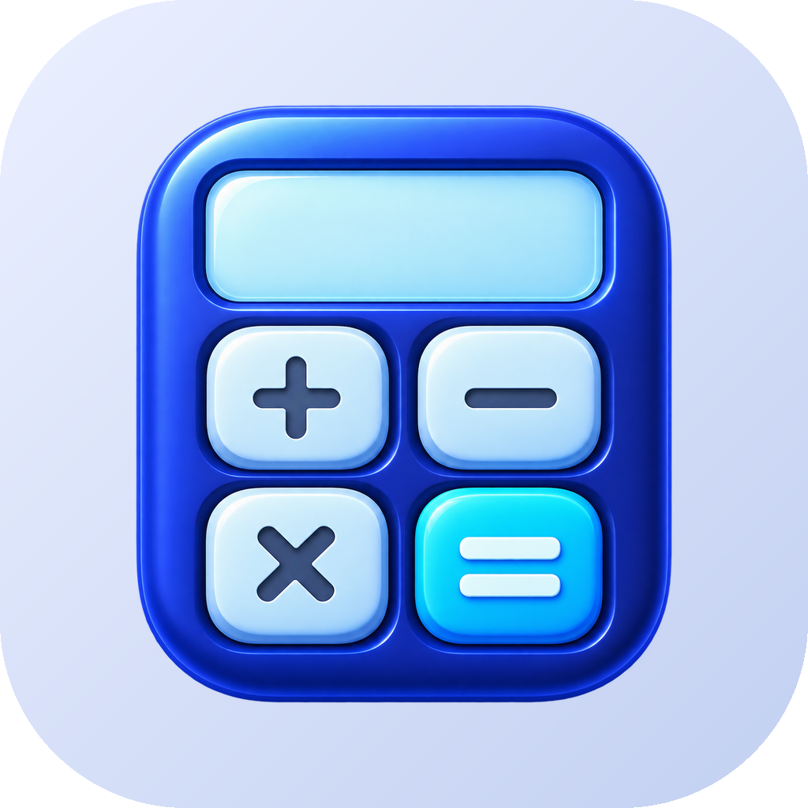

# OpenCalc

**Kalkulator naukowy, wykresy, przeliczniki jednostek i kilkanaście narzędzi w jednej aplikacji na Androida.** Czarno-biały interfejs w stylu OpenPDF, bez reklam, śledzenia i konta – wszystko liczy się w telefonie.

## Pobieranie

Najnowsza wersja jest na **[redzikowski.com/portfolio/opencalc](https://redzikowski.com/portfolio/opencalc)**. Aplikacja sama sprawdza i instaluje kolejne wersje (Android 10 / API 29 lub nowszy).

## Możliwości

| Zakładka | Co potrafi |
|---|---|
| **Kalkulator** | Edycja z kursorem, podgląd wyniku, funkcje naukowe (2nd, hyp), DEG/RAD/GRAD, historia z przypinaniem, pamięć M, zmienne A–F, Ans, wynik jako ułamek, zapis naukowy i inżynierski, HEX/BIN/OCT, ° ′ ″ |
| **Wykresy** | Do 8 funkcji, przesuwanie i powiększanie palcami, odczyt wartości dotknięciem, pochodna, miejsca zerowe, ekstrema, przecięcia |
| **Przeliczniki** | 17 kategorii (długość, powierzchnia, objętość, masa, temperatura, prędkość, czas, dane, transfer, ciśnienie, energia, moc, siła, kąt, częstotliwość, spalanie, kuchnia) |
| **Narzędzia** | Równania i układy, analiza funkcji (f(x)=0, pochodna, całka), statystyka i regresja, macierze, systemy liczbowe i bity, ułamki, teoria liczb i liczby rzymskie, procenty, VAT, kredyt z harmonogramem, lokata z podatkiem Belki, daty, koszt podróży, napiwek, BMI, kwota słownie |

### Składnia wyrażeń
`2π`, `3(4+1)`, `x²`, `2^10`, `5!`, `√2`, `∛27`, `|x|`, `7 mod 3`, `200+10%`, `1,5E−3`, `sin30°`, `log(8; 2)`, `nCr(49; 6)`, `gcd(12; 18)`. Brakujące nawiasy zamykające są dopisywane automatycznie.

## Wydania

Budowanie i publikacja odbywają się wyłącznie po wypchnięciu tagu `vX.Y.Z` zgodnego z plikiem `VERSION`.

---
Pomysł i wykonanie: **Adam Rędzikowski** · [redzikowski.com](https://redzikowski.com) · [Postaw kawę](https://buycoffee.to/adamredzikowski)
